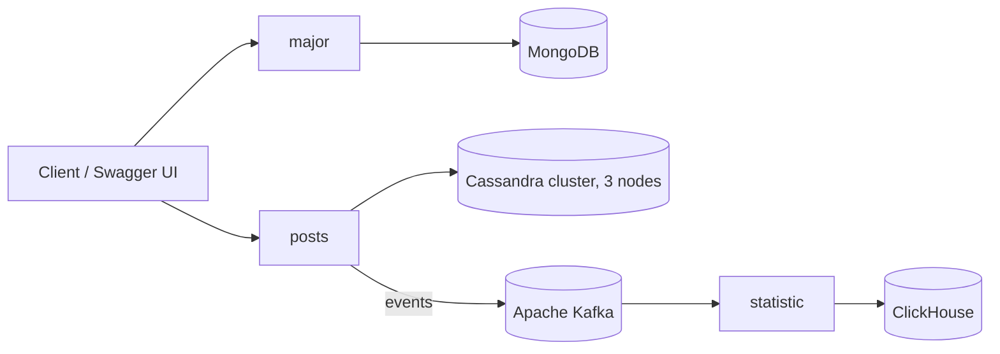

# SOA Social Network

[](https://go.dev/)
[](https://www.docker.com/)
[](https://grpc.io/)
[](https://www.mongodb.com/)
[](https://cassandra.apache.org/)
[](https://kafka.apache.org/)
[](https://clickhouse.com/)

Проект емонстрирует проектирование и инфраструктурную сборку **сервис-ориентированной архитектуры (SOA)** для социальной сети. Проект оформлен как набор взаимодействующих микросервисов с разными хранилищами, асинхронной передачей событий и контейнерной оркестрацией.

> **Роль:** backend / architecture pet-project  
> **Цель:** показать навыки проектирования распределённых сервисов, выбора хранилищ под задачу и описания архитектуры через C4/ER-диаграммы и API-спецификации.

---

## О проекте

Репозиторий содержит архитектурный и инфраструктурный каркас социальной сети, разделённый на независимые сервисы. Основной акцент сделан не на готовом продукте, а на **архитектурных решениях**: разделении ответственности, полиглотном хранении данных, gRPC/REST-взаимодействии и асинхронной обработке статистики.

Проект развивался как последовательность учебных заданий и в итоге оформлен как единый pet-проект для портфолио.

---

## Архитектура



---

## Сервисы

| Сервис | Назначение | Хранилище / взаимодействие |
|---|---|---|
| `major` | Центральный сервис: пользователи, аутентификация, базовое API | MongoDB, REST/Swagger, JWT |
| `posts` | Работа с публикациями | Apache Cassandra, кластер из 3 узлов |
| `statistic` | Сбор и обработка статистики | Apache Kafka → ClickHouse |

---

## Ключевые архитектурные решения

- **Разделение на сервисы по предметным областям** — пользователи, посты и статистика развиваются независимо.
- **Полиглотное хранение данных** — под каждую задачу выбрано подходящее хранилище: MongoDB, Cassandra, ClickHouse.
- **Асинхронная обработка событий** — статистика получает данные через Kafka, что снижает связанность сервисов.
- **gRPC и REST** — gRPC для межсервисного взаимодействия, REST/Swagger для внешнего API.
- **JWT-аутентификация** — используется в сервисе `major`.
- **Контейнеризация** — все компоненты поднимаются через Docker Compose.
- **Проектная документация** — C4-модели, ER-диаграммы и Swagger-спецификация.

---

## Технологический стек

- **Язык:** Go 1.22
- **API:** gRPC, REST, Swagger/OpenAPI
- **Аутентификация:** JWT
- **Базы данных:** MongoDB, Apache Cassandra, ClickHouse
- **Брокер сообщений:** Apache Kafka + Zookeeper
- **Инфраструктура:** Docker, Docker Compose
- **Документирование архитектуры:** PlantUML, C4, ER-диаграммы

---

## Документация

В директории `doc` находятся артефакты проектирования:

- `c4-context.puml` — C4-диаграмма контекста.
- `c4-containers.puml` — C4-диаграмма контейнеров.
- ER-диаграммы сущностей `user`, `post`, `comment`, `statistic`.
- `swagger.yaml` — спецификация API сервиса `major`.

---

## Быстрый старт

```bash
git clone https://github.com/Navalgan/Service-oriented-architectures.git
cd Service-oriented-architectures
docker compose up --build -d
```

После запуска компоненты доступны через Docker Compose. Swagger-спецификация для сервиса `major` находится в `doc/swagger.yaml`.

Остановить инфраструктуру:

```bash
docker compose down
```

---

## Что демонстрирует проект

- Проектирование SOA-системы для предметной области «социальная сеть».
- Выбор и обоснование разных хранилищ под разные сценарии нагрузки.
- Организацию асинхронного обмена событиями через Kafka.
- Использование gRPC и REST в одном проекте.
- Подготовку архитектурной документации: C4, ER, Swagger.
- Сборку распределённой инфраструктуры через Docker Compose.

---

## Статус

Проект представляет собой архитектурный и инфраструктурный каркас распределённой системы. Основная ценность — демонстрация архитектурных решений, выбора технологий под задачи и подхода к документированию сервисов.
